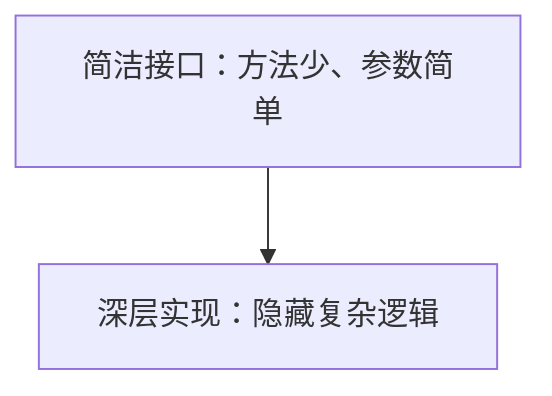
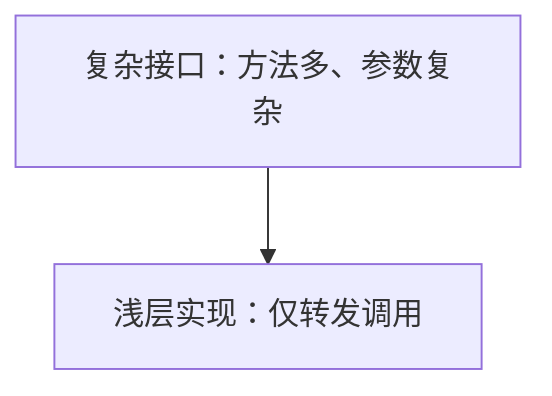

# 代码库设计

设计**深层模块**：将大量行为放在一个简洁接口之后，放置在清晰的接缝处，并通过该接口进行测试。设计或重构任何代码时，都应使用这里的词汇和原则。目标是让调用方获得更大能力，让维护人员的工作集中，并让所有人都能方便地测试。

## 术语表

请准确使用这些术语：不要替换成“组件”、“服务”、“API”或“边界”。一致的语言正是此处的全部目的。

**模块（Module）**：任何同时具有接口和实现的事物。刻意不限定规模：可以是函数、类、程序包，或跨多个层级的代码切片。_避免使用：_单元、组件、服务。

**接口（Interface）**：调用方正确使用模块所必须了解的一切：类型签名，以及不变量、顺序约束、错误模式、必需配置和性能特征。_避免使用：_API、签名（范围太窄，只指类型层面的外在形式）。

**实现（Implementation）**：模块内部的内容，即其中的代码。它不同于**适配器（Adapter）**：一个事物可以是实现很大的小型适配器（Postgres 仓储），也可以是实现很小的大型适配器（内存中的假实现）。接缝是讨论重点时使用“适配器”，其他时候使用“实现”。

**深度（Depth）**：接口所提供的调用方收益。它表示调用方（或测试）每了解一个单位的接口，就可以使用多少行为。一个模块在简洁接口后承载大量行为时就是**深层**模块；接口与实现几乎同样复杂时就是**浅层**模块。

**接缝（Seam）**（Michael Feathers）：可以在某处之外更改该处行为的位置；模块接口所处的**位置**。接缝放在哪里是单独的设计决策，与接缝之后放置什么内容不同。_避免使用：_边界（它在领域驱动设计的有界上下文中已有专门含义）。

**适配器（Adapter）**：在接缝处满足接口的具体事物。它描述的是**角色**（它填补什么位置），而不是内容（它内部有什么）。

**调用方收益（Leverage）**：调用方从深度获得的收益。每单位所了解的接口都能提供更多能力。一种实现可以在 N 个调用位置和 M 个测试中发挥作用。

**局部集中度（Locality）**：维护人员从深度获得的好处。更改、错误、知识和验证集中在一处，而不是散布到各个调用方。修复一次，所有地方都得到修复。

## 深层模块和浅层模块

**深层模块** = 简洁接口 + 大量实现：



**浅层模块** = 大量接口 + 少量实现（应避免）：



设计接口时，询问：

- 能否减少方法数量？
- 能否简化参数？
- 能否在内部隐藏更多复杂性？

## 原则

- **深度是接口的属性，而不是实现的属性。** 深层模块内部可以由小型、可模拟、可替换的部分组成，只要这些部分不属于接口即可。模块可以同时具有**内部接缝**（实现内部的私有接缝，由模块自身的测试使用）和接口处的**外部接缝**。
- **删除模块检验。** 想象删除模块。如果复杂性随之消失，那么它只是在转发调用。如果复杂性又在 N 个调用方中出现，那么它就证明了自身的价值。
- **接口就是测试面。** 调用方和测试通过相同接缝。如果要越过接口深入模块内部进行测试，这个模块的形态可能有问题。
- **一个适配器代表假设中的接缝。两个适配器代表真实接缝。** 除非确实存在变化，否则不要引入接缝。

## 便于测试的设计

好的接口让测试变得自然：

1. **接收依赖，不要自行创建依赖。**

   ```typescript
   // Testable
   function processOrder(order, paymentGateway) {}

   // Hard to test
   function processOrder(order) {
     const gateway = new StripeGateway();
   }
   ```

2. **返回结果，不要产生副作用。**

   ```typescript
   // Testable
   function calculateDiscount(cart): Discount {}

   // Hard to test
   function applyDiscount(cart): void {
     cart.total -= discount;
   }
   ```

3. **保持外在形式简洁。** 方法越少，需要的测试越少。参数越少，测试设置越简单。

## 关系

- 一个**模块**恰好有一个**接口**（它向调用方和测试提供的外在形式）。
- **深度**是**模块**的属性，以其**接口**为衡量依据。
- **接缝**是**模块**的**接口**所在位置。
- **适配器**位于**接缝**处，并满足**接口**。
- **深度**为调用方带来**调用方收益**，为维护人员带来**局部集中度**。

## 不接受的表述

- **将深度视为实现代码行数与接口代码行数的比率**（Ousterhout）：这会鼓励填充实现。我们采用“深度即调用方收益”的定义。
- **将“接口”仅视为 TypeScript 的 `interface` 关键字或类的公开方法**：范围太窄；这里的接口包括调用方必须了解的所有事实。
- **“边界”**：它与领域驱动设计的有界上下文概念冲突。请使用**接缝**或**接口**。

## 深入了解

- 根据依赖关系加深一组模块，请参阅 [DEEPENING.md](DEEPENING.md)：依赖类别、接缝纪律，以及替换测试而非叠加测试的做法。
- 探索不同接口，请参阅 [DESIGN-IT-TWICE.md](DESIGN-IT-TWICE.md)：启动多个并行子代理，以截然不同的方式设计接口，然后根据深度、局部集中度和接缝位置进行比较。
