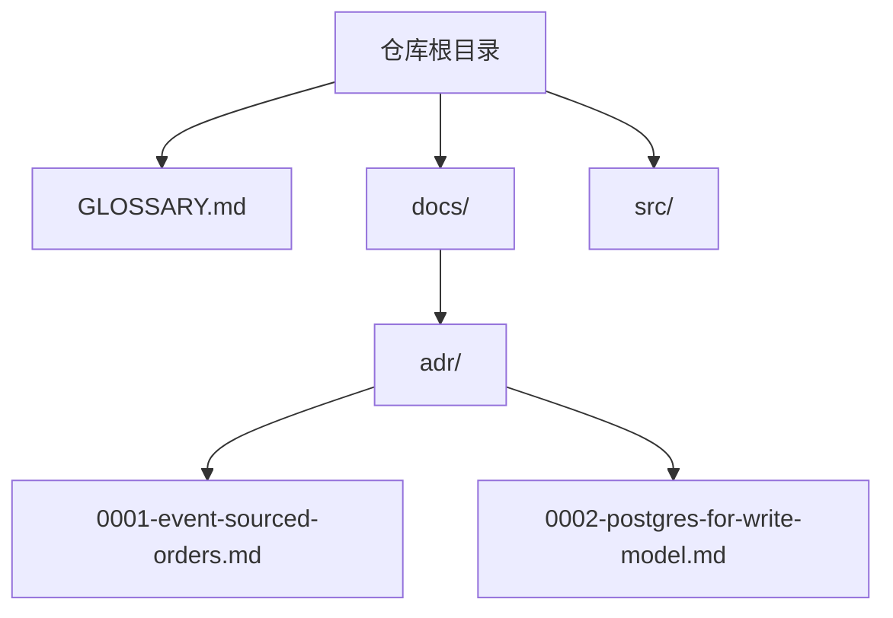
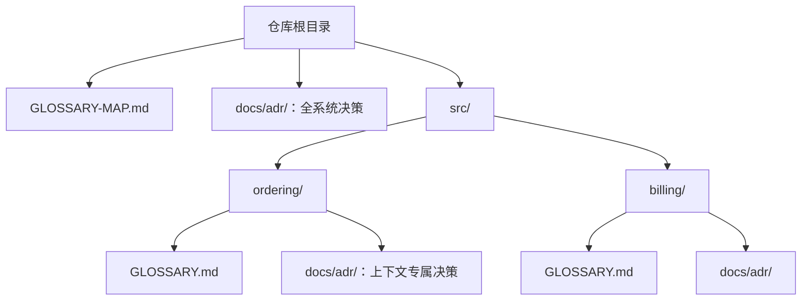

# 领域建模

在设计过程中主动建立并打磨项目的领域模型。这是一项*主动*实践：质疑术语、设想边缘情形，并在词义和决定刚刚明确时立即写入术语表和决策记录。（仅为了解词汇而*阅读* `GLOSSARY.md` 不属于此技能：任何技能都可以养成这个简单习惯。此技能用于修改模型，而不仅仅是使用模型。）

## 文件结构

大多数仓库只有一个上下文：

如果根目录存在 `GLOSSARY-MAP.md`，则仓库有多个上下文。该映射会指向每个上下文所在的位置：

按需创建文件：只有需要写入内容时才创建。如果不存在 `GLOSSARY.md`，则在第一个术语得到确认时创建。如果不存在 `docs/adr/`，则在需要第一个 ADR 时创建。

## 会话期间

### 对照术语表进行质疑

当用户使用的术语与 `GLOSSARY.md` 中的既定用语冲突时，立即指出来。“你的术语表把‘cancellation’定义为 X，但你似乎指的是 Y。到底是哪一种？”

### 打磨模糊的措辞

当用户使用含糊或含有多种含义的术语时，提出一个精确的规范术语。“你说‘account’时，指的是 Customer 还是 User？它们是不同的概念。”

### 讨论具体情形

讨论领域关系时，用具体情形检验它们。设想探查边缘情形的场景，并迫使用户明确概念之间的边界。

### 跨引用代码

当用户说明某项功能的运作方式时，检查代码是否一致。如果发现矛盾，就指出来：“你的代码会取消整个 Order，但你刚才说可以部分取消。哪种说法才正确？”

### 当场更新 GLOSSARY.md

术语得到确认后，立即更新 `GLOSSARY.md`。不要攒起来之后再写：应当在确认发生时记录。使用 [GLOSSARY-FORMAT.md](./GLOSSARY-FORMAT.md) 中的格式。

`GLOSSARY.md` 不应包含任何实现细节。不要把 `GLOSSARY.md` 当作规格说明、草稿区或实现决策存放处。它只是术语表。

### 谨慎提出 ADR

只有以下三项全部成立时才提出创建 ADR：

1. **难以撤销**：以后改变主意的代价不容忽视
2. **没有背景时会令人意外**：未来的读者会想“为什么要这样做？”
3. **确实存在取舍**：有真正可行的替代方案，并且你基于具体原因选择了其中一个

缺少任何一项，就跳过 ADR。使用 [ADR-FORMAT.md](./ADR-FORMAT.md) 中的格式。
