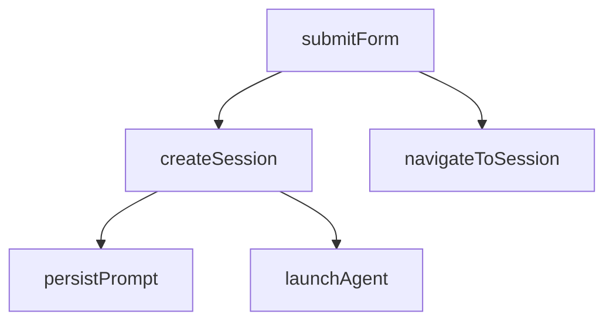
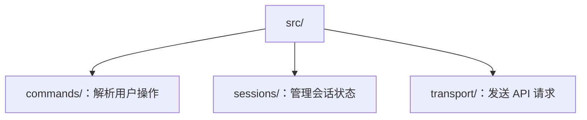
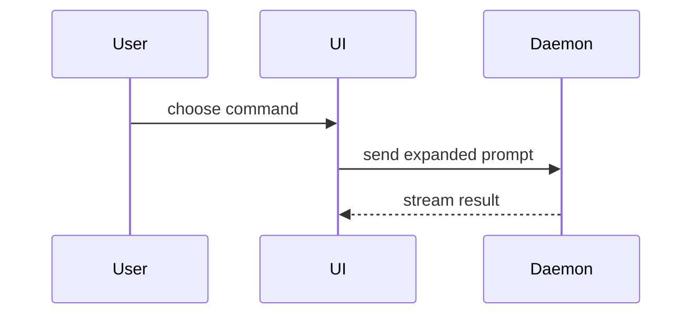
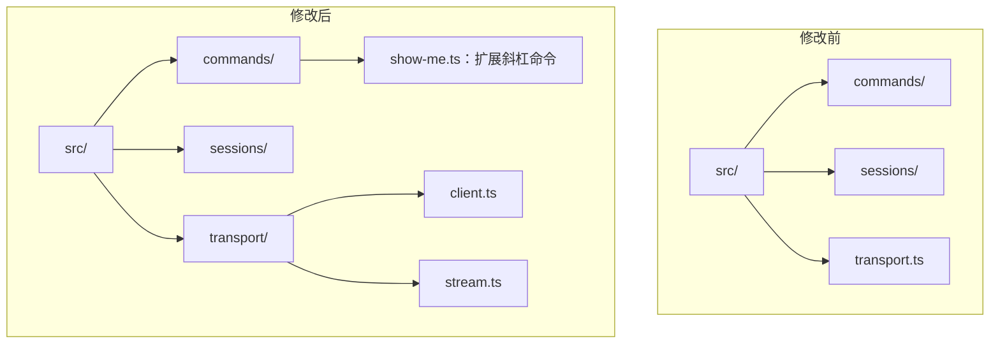

使用此模板撰写 PR 正文：

```markdown
## 摘要

<图示、差异草图或目录树>

## 证据

- **之前：** <截图/输出/失败的测试运行>
  **之后：** <截图/输出/通过的测试运行>

## 合并风险

**可逆性：** <单向或双向>

<可选：说明>

**影响范围：** <一个词的说明>

<可选：合并可能造成的影响>
```

## 章节

省略所有前言，保持文字简洁。使用用户的领域语言，并遵循 `GLOSSARY.md`。

### 摘要

选择能清楚说明要点的最精简视图。

- 使用伪代码展示逻辑或算法：

```text
on(save)
  if content is unchanged
    return cached result
  write new content
  return fresh result
```

- 使用调用树展示运行时控制流程：



- 使用组件树展示用户界面结构，包括重要的状态和模块边界：

```text
<SessionPage> (apps/example/src/routes/session.tsx)
  useSessionEvents()
  <SessionToolbar>
    <RunSkillButton> (packages/ui)
```

- 使用浅层文件树展示文件职责或较大范围的重构：



- 使用 Mermaid 展示组件交互、控制流程或数据流：



- 如果要点是有哪些更改，并且周边结构已经存在，则使用 `diff`。让差异的形式与主题相符。

组件更改示例：

```diff
 <SessionPage>
   useSessionEvents()
   <SessionToolbar>
+    <RunSkillButton />
   <SessionTimeline>
+    <SkillResultCard />
```

文件布局更改示例：



调用树或调用层级更改示例：

```diff
 submitForm
   createSession
     persistPrompt
+    expandSkillMention
     launchAgent
-  navigateToSession
+  navigateToSession
+    subscribeToEvents
```

状态或控制流程更改示例：

```diff
 on(save)
-  write content
+  if content is unchanged
+    return cached result
+  write new content
+  invalidate cache
```

- 如果大部分内容都是新增的、省略上下文会隐藏所有权或顺序，或用户需要可复制的目标形态，则展示整个代码块：

```ts
function expandSkill(command: string): string {
  const skillName = command.slice(1);
  return `use the ${skillName} skill`;
}
```

#### 指引

将每种图示放在它所支持的简短文字旁边。只保留回答用户当前问题或解决当前讨论事项所需的调用、文件、属性、状态和边界。

你可以使用其中一种，也可以使用多种，但不太可能全部用上。请自行判断，不要让用户应接不暇。

### 证据

提供证明更改有效的具体证据。展示更改前后的情况。

截图属于最高等级的证据，在环境已经设置好且更改带有视觉效果时使用。

基于执行结果的证据属于 A 级证据。可以展示测试运行结果或控制台输出；准确展示此前失败、现已通过的测试用例，可采用伪代码说明。

### 合并风险

说明此次更改可逆还是不可逆。双向操作可以恢复，单向操作则不能。容易回滚的 PR 风险较低。涉及破坏性操作或难以撤销决策的更改属于单向操作。

影响范围是此 PR 引入更改的潜在影响或范围。考虑所有可能性，例如布局变化、使用方故障、移动设备响应能力等。
