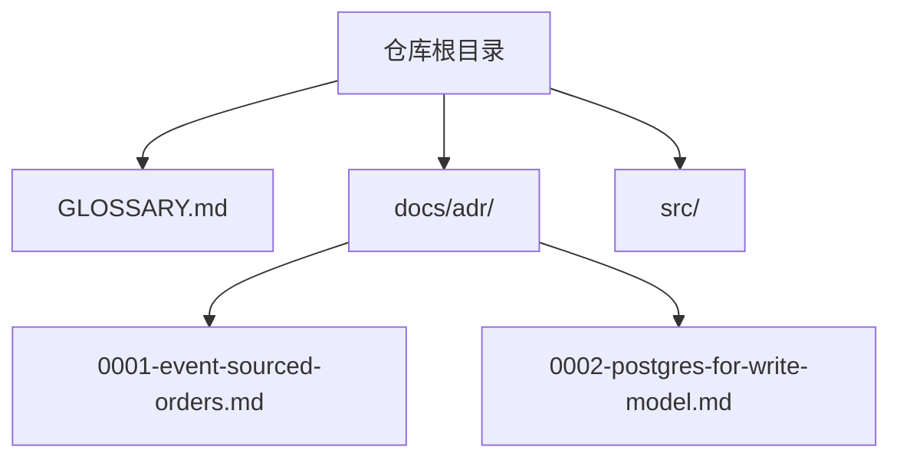
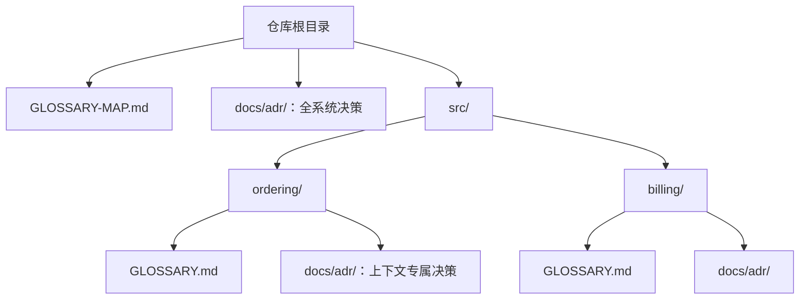

# 领域文档

在探索代码库时，工程技能应如何使用本仓库的领域文档。

## 探索前，请阅读这些内容

- 仓库根目录的 **`GLOSSARY.md`**，或
- 如果存在，仓库根目录的 **`GLOSSARY-MAP.md`**：它会为每个上下文指向一个 `GLOSSARY.md`。阅读所有与主题相关的文件。
- **`docs/adr/`**：阅读涉及你即将处理领域的 ADR。在多上下文仓库中，还要检查 `src/<context>/docs/adr/` 中上下文范围内的决策。

如果其中任何文件不存在，**请安静地继续**。不要指出这些文件缺失，也不要建议预先创建它们。`/domain-modeling` 技能(通过 `/grill-with-docs` 和 `/improve-codebase-architecture` 使用)会在术语或决策实际得到确认时按需创建这些文件。

## 文件结构

单一上下文仓库(大多数仓库)：

多上下文仓库(根目录存在 `GLOSSARY-MAP.md`)：

## 使用术语表中的词汇

当输出中提到领域概念时(例如问题标题、重构提案、假设或测试名称)，使用 `GLOSSARY.md` 中定义的术语。不要改用术语表明确避免的同义词。

如果你需要的概念还没有列入术语表，这就是一个信号：要么你正在发明项目并未使用的语言(请重新考虑)，要么确实存在缺口(为 `/domain-modeling` 记录下来)。

## 标出 ADR 冲突

如果输出与现有 ADR 矛盾，请明确指出，而不是默默覆盖：

> _与 ADR-0007(event-sourced orders)矛盾，但值得重新审议，因为……_
