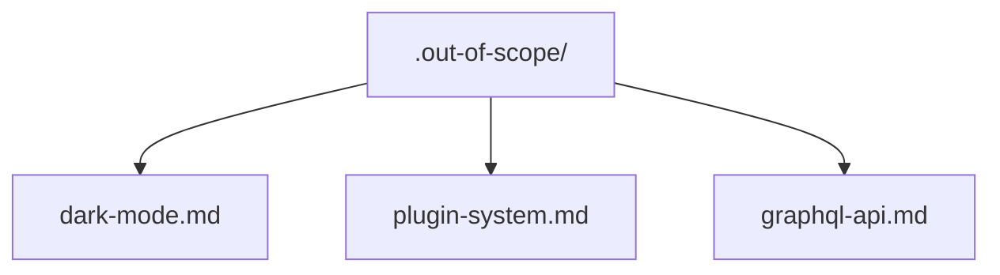

# 范围外知识库

仓库中的 `.out-of-scope/` 目录用于持续记录被拒绝的功能请求。它有两个用途：

1. **组织记忆**：记录功能被拒绝的原因，避免问题关闭后丢失理由
2. **去重**：新问题与以前被拒绝的请求匹配时，技能可以显示先前的决定，而不是重新讨论一遍

## 目录结构



每个**概念**对应一个文件，而不是每个问题各用一个文件。多个问题请求同一功能时，归入同一个文件。

## 文件格式

文件应使用轻松、易读的行文风格，更像简短的设计文档，而不是数据库记录。通过段落、代码示例和例子说明理由，让第一次接触该记录的人也能理解并从中获益。

````markdown
# Dark Mode

本项目不支持深色模式或面向用户的主题设置。

## Why this is out of scope

渲染流程假设只有一种颜色方案，由
`ThemeConfig` 定义。支持多种主题需要：

- 使用主题上下文提供器包装整个组件树
- 按组件解析与主题相关的样式
- 持久保存用户主题偏好的机制

这是一项重大的架构变更，与本项目专注内容创作的方向不符。主题属于下游使用者的需求，他们会嵌入或重新分发输出内容。

```ts
// The current ThemeConfig interface is not designed for runtime switching:
interface ThemeConfig {
  colors: ColorPalette; // single palette, resolved at build time
  fonts: FontStack;
}
```

## Prior requests

- #42: "Add dark mode support"
- #87: "Night theme for accessibility"
- #134: "Dark theme option"
````

### 文件命名

为概念使用简短、具描述性的 kebab-case 名称：`dark-mode.md`、`plugin-system.md`、`graphql-api.md`。名称应清晰到足以让浏览目录的人知道被拒绝的内容，而无需打开文件。

### 编写理由

理由应有实质内容，不要只写“我们不想要这个”，而要说明原因。良好的理由会引用：

- 项目范围或理念（“本项目专注于 X；主题设置属于下游关注事项”）
- 技术限制（“支持该功能需要 Y，这与我们的 Z 架构冲突”）
- 策略决定（“我们选择使用 A 而不是 B，因为……”）

理由应当长期有效。避免引用临时情况（“我们目前太忙了”）；这不是拒绝，而是推迟处理。

## 何时检查 `.out-of-scope/`

分流期间（第 1 步：收集上下文）读取 `.out-of-scope/` 中的所有文件。评估新问题时：

- 检查请求是否符合现有范围外概念
- 按照概念相似度而不是关键词进行匹配：“夜间主题”与 `dark-mode.md` 匹配
- 如果存在匹配项，向维护人员指出：“此请求与 `.out-of-scope/dark-mode.md` 相似。我们以前拒绝过此请求，原因是[理由]。你现在的看法仍然相同吗？”

维护人员可以：

- **确认**：将新问题添加到现有文件的“Prior requests”列表，然后关闭问题
- **重新考虑**：删除或更新范围外文件，并按照正常分流流程处理问题
- **不同意**：两个问题相关但并不相同，按照正常分流流程处理

## 何时写入 `.out-of-scope/`

只有当某项**功能增强**（不是错误）被标为 `wontfix` 而*拒绝*时才写入。此规则对功能增强 PR 与 issues 完全相同：被拒绝的 PR 也要记录在这里，避免同一请求以新代码的形式再次出现。

如果某项内容因为**已经实现**而被标记为 `wontfix`，**不要**写入这里。它是已实现的功能，不是被拒绝的功能；记录此内容会让去重检查错误地认为该功能遭到拒绝。此时应在关闭评论中指出已实现的功能所在位置。

流程如下：

1. 维护人员决定某项功能请求超出范围
2. 检查 `.out-of-scope/` 中是否已经存在匹配的文件
3. 如果存在：将新问题追加到“Prior requests”列表
4. 如果不存在：使用概念名称创建新文件，写入决定、理由和第一个先前请求
5. 在问题上发表评论，解释决定并提及 `.out-of-scope/` 文件
6. 使用 `wontfix` 标签关闭问题

## 更新或移除范围外文件

如果维护人员改变对先前被拒绝概念的看法：

- 删除 `.out-of-scope/` 文件
- 技能无需重新打开旧问题；它们是历史记录
- 触发重新考虑的新问题按照正常分流流程继续处理
